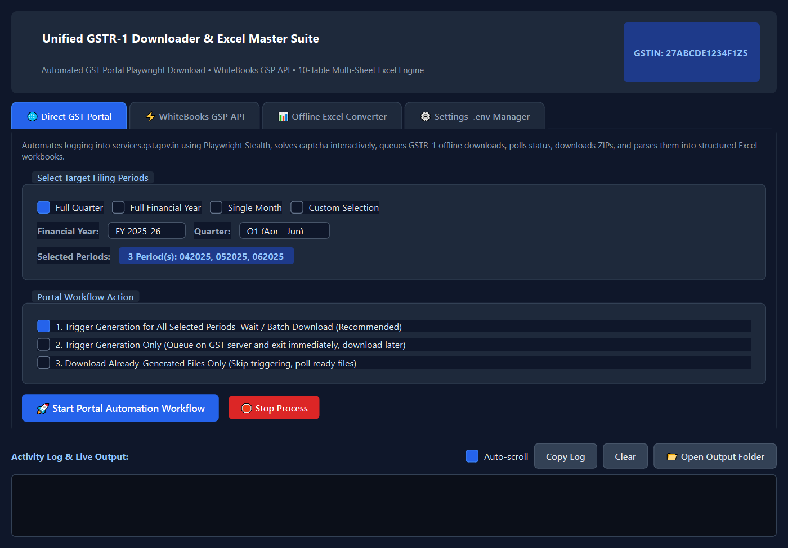

# Unified GSTR-1 Downloader & Excel Master Suite

A modern desktop GUI and automation suite for downloading and converting GSTR-1 return payloads into structured, multi-sheet Excel workbooks.



---

## 🌟 Key Features

- **🌐 Direct Govt GST Portal Automation**:
  - Headless Playwright browser automation with stealth evasions.
  - Interactive **in-app Captcha dialog** with image rendering and one-click refresh (no terminal input required).
  - Two-Phase Batch Workflow: Queue all selected return periods upfront, poll status, download ZIPs, and extract JSONs automatically.
- **⚡ WhiteBooks GSP API Integration**:
  - Direct API download via official GSP endpoints.
  - Interactive OTP verification modal with sandbox default (`575757`) support.
- **📊 10-Table Multi-Sheet Excel Engine**:
  - Parses raw GSTR-1 JSON payloads into structured Excel workbooks with all 10 standard tables:
    1. Summary
    2. B2B (Business-to-Business invoices)
    3. B2CL (B2C Large invoices)
    4. B2CS (B2C Small supplies)
    5. CDNR (Credit/Debit Notes Registered)
    6. CDNUR (Credit/Debit Notes Unregistered)
    7. EXP (Exports)
    8. NIL_Exempt (Nil, Exempt, and Non-GST supplies)
    9. HSN (HSN/SAC summary of outward supplies)
    10. Doc_Issued (Document issuance summary)
- **📑 Master Consolidation**:
  - Automatically merges all monthly/quarterly JSON files into a single master Excel workbook (`GSTR1_{GSTIN}_CONSOLIDATED.xlsx`) with return period tags.
- **📅 Interactive Period Selector**:
  - Single-click selection for **Full Quarter (Q1–Q4)**, **Full Financial Year (12 months)**, **Single Month**, or **Custom Month Chips**.
- **⚙️ Visual Settings & .env Manager**:
  - Inspect, edit, and toggle passwords for GST portal and API credentials directly in the GUI.

---

## 🚀 Quick Start (Standalone .exe — No Python Required)

1. Download the latest **`GSTR1_Master_Suite.exe`** from the [Releases](https://github.com/Prog38059/gstr1-downloader/releases) section.
2. Double-click **`GSTR1_Master_Suite.exe`** to launch the GUI.
3. Configure your credentials in the **Settings & .env Manager** tab and click **Save Configuration**.
4. Select your target period and run your download or conversion workflow!

> [!NOTE]
> On Windows 10/11, browser automation automatically leverages your installed **Microsoft Edge** or **Google Chrome**. No browser downloads or manual configurations are needed.

---

## 💻 Running from Source Code

If you prefer to run or develop from the Python source:

### 1. Clone the repository
```bash
git clone https://github.com/Prog38059/gstr1-downloader.git
cd gstr1-downloader
```

### 2. Install dependencies
```bash
pip install -r requirements.txt
```

### 3. Configure `.env`
Copy `.env.example` to `.env`:
```bash
copy .env.example .env
```
Fill in your GST login credentials or WhiteBooks API keys (or configure via the GUI Settings tab).

### 4. Launch Application
- **GUI Mode**:
  ```bash
  python run.py
  ```
  *(or double-click `run_gui.bat`)*
- **Classic CLI Mode**:
  ```bash
  python run.py --cli
  ```

---

## 🛠️ Rebuilding the Standalone Executable

To compile a single, self-contained `.exe` after making code modifications:
```bash
python build_exe.py
```
The compiled single-file executable will be generated at `dist/GSTR1_Master_Suite.exe`.

---

## 🔒 Security & Privacy Notice
- Taxpayer data, credentials, and downloaded GST return files are excluded from Git via `.gitignore`.
- All credentials are saved strictly in your local `.env` file on your machine and are never transmitted to any third-party servers.
